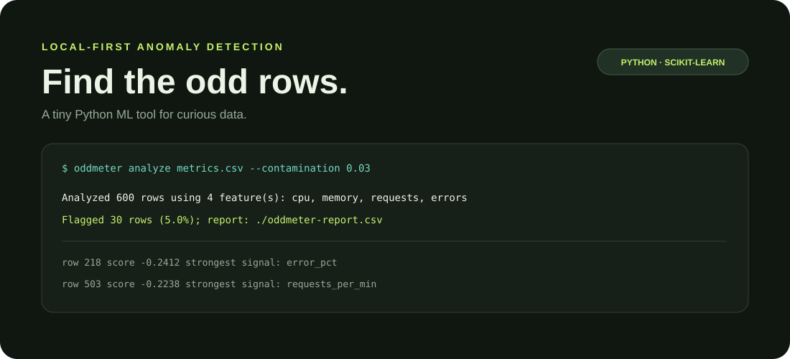

# OddMeter

**Find the odd rows hiding in your CSV.** OddMeter is a small, local-first Python CLI that uses an Isolation Forest to spot unusual records in numeric tabular data and writes a ranked, annotated CSV report.



## Quick start

Python 3.10 or newer is required.

```bash
python -m venv .venv
source .venv/bin/activate   # Windows: .venv\Scripts\activate
python -m pip install -e .
oddmeter demo
```

The demo creates 600 synthetic service-telemetry rows, injects unusual events, trains the detector, prints a small labeled sanity check, and writes `oddmeter-report.csv`.

## Analyze your own CSV

```bash
oddmeter analyze metrics.csv --output report.csv
```

OddMeter automatically selects columns that contain numeric values. Choose features explicitly and tune the expected outlier fraction (default 5%) when useful:

```bash
oddmeter analyze metrics.csv \
  --features cpu_pct memory_pct requests_per_min error_pct \
  --contamination 0.03 \
  --output flagged.csv
```

Missing numeric cells are median-imputed. Non-numeric columns are retained in the output but not used by the model. The report includes the original fields, 1-based CSV data-row number, anomaly flag, Isolation Forest score (lower is more unusual), and a `main_signal` hint: the feature with the largest median/IQR deviation for that row. That hint is a descriptive heuristic, **not** a causal explanation of the model decision.

If a labeled column is available, an optional comparison can be printed with `--demo-label is_anomaly`. Labels must use `1`, `true`, `yes`, `anomaly`, or `outlier` for positive examples. Labels are not used to train the unsupervised detector.

## How it works

1. Select numeric features from the CSV.
2. Median-impute missing values and standardize columns.
3. Fit scikit-learn's `IsolationForest` with a fixed random seed.
4. Sort unusual records by `score_samples` and export the results.

All data processing happens on your machine. No account, API key, telemetry, or cloud service is involved. The contamination setting is a modeling assumption, not a guaranteed real-world anomaly rate; review flagged rows in context before acting on them.

## Development

```bash
python -m pip install -e '.[test]'
pytest
```

## License

MIT — see [LICENSE](LICENSE).
